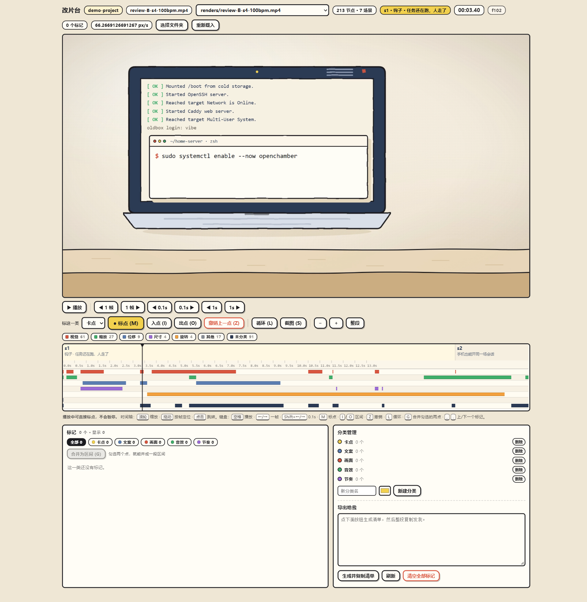

# 改片台

面向 AI 视频改片的本地人工复核台：在时间轴上逐帧定位问题、写清楚要改什么，一键导出结构化清单，直接粘给 AI 执行。



## 为什么做这个

AI 直出的视频经常「大方向对、细节错」：某个转场太快、某句字幕压字、某个镜头该删。用自然语言描述「大概第 3 秒那里」既费劲又容易歧义，来回几轮也改不准。

改片台把这件事拆成两步：

1. **人来做判断**：在播放器上定位到具体时间点，写备注、打分类；
2. **AI 来做执行**：导出「时间点 + 问题 + 期望改法」的清单，AI 按条目改，不再靠猜。

这正好是「哪些环节交给 AI、哪些必须人工把关」的一个具体答案。

## 功能

- 加载 HyperFrames 项目，自动扫描视频与动画节点
- 视频播放、逐帧定位、时间点打点
- 每个标记支持备注、分类、截图
- 标记的编辑、合并、删除、清空
- 关键帧表按轨道分组展示（示例项目：213 个动画节点、50 个视频）
- 一键生成清单并复制到剪贴板，直接发给 AI
- 失败切换项目时保留上一个项目可用

## 技术实现

- **零依赖**：只用 Node.js 内置模块（`http`、`fs`、`path`、`child_process`），不需要 `npm install`
- **HTTP API**：
  - `GET /api/state`、`/api/meta`、`/api/keyframes`、`/api/videos`
  - `POST /api/project/pick`、`/api/project/set`、`/api/reload`
  - `POST /api/mark`、`/api/mark/update`、`/api/mark/delete`、`/api/mark/merge`、`/api/mark/clear`
  - `POST /api/cat`、`/api/cat/delete`、`/api/shot`
- **视频服务**：支持 Range 请求（206），并做路径穿越校验
- **前端**：单页 `public/editor.html`，无框架、无构建步骤
- **测试**：`node:test`，120 个用例全部通过，单元测试覆盖 store / keyframes / media / paths / scan / dialog / tweentable，契约测试覆盖 12 条主要路由

## 快速开始

```bash
node serve.cjs
```

打开 http://127.0.0.1:8903/ ，在页面里选择项目文件夹即可。

端口可通过环境变量覆盖：

```bash
PORT=9000 node serve.cjs
```

## 测试

```bash
node --test
```

## 目录结构

```
改片台/
├─ serve.cjs              # HTTP 服务与路由
├─ lib/
│  ├─ config.js           # 端口、视频扩展名、扫描限制
│  ├─ paths.js            # 路径校验
│  ├─ scan.js             # 项目扫描
│  ├─ keyframes.js        # 关键帧表生成
│  ├─ tweentable.js       # 动画节点整理
│  ├─ store.js            # 标记持久化
│  ├─ media.js            # 视频 Range 服务
│  └─ dialog.js           # 系统选择框
├─ public/editor.html     # 单页前端
├─ test/
│  ├─ contract/           # 路由契约测试
│  └─ unit/               # 单元测试
└─ data/                  # 本地状态（不入库）
```

## 说明

- `data/settings.json` 记录上次打开的项目路径，属于本地状态，已在 `.gitignore` 中排除
- 项目依赖 HyperFrames 的目录结构；普通文件夹也能加载，只是没有动画节点

## License

MIT
